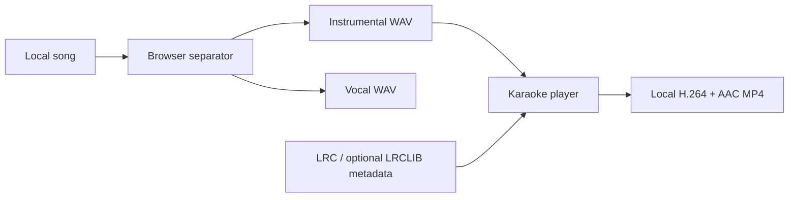

<div align="center">
  

  # OpenKaraoke Studio

  **Turn a song you own into private, synchronized karaoke—entirely in your browser.**

  [](LICENSE)
  
  
  

  [Features](#what-it-does) · [Run locally](#run-locally) · [Deploy](#deploy-to-vercel) · [Contribute](CONTRIBUTING.md)
</div>

---

OpenKaraoke Studio is a free, open-source, mobile-first karaoke creator built with Vite, React and TypeScript. Import an MP3/WAV, remove vocals locally, synchronize real lyrics, preview the result and export a standards-based MP4—without an account, subscription, paid API or mandatory server.

> [!IMPORTANT]
> Process only audio and lyrics you have permission to use. The project does not download songs or bypass streaming-service protections.

## What it does

| Step | Capability |
| --- | --- |
| **1 · Upload** | Reads local MP3/WAV and browser-supported FLAC metadata without uploading or fully decoding the file. |
| **2 · Separate** | Runs `UVR-MDX-NET-Inst_HQ_3` locally through ONNX Runtime Web and produces instrumental + vocal WAV stems. |
| **3 · Synchronize** | Imports UTF-8 LRC, searches LRCLIB by title/artist/duration, or lets users timestamp supplied lyrics manually. |
| **4 · Preview** | Plays the instrumental with current/next-line highlighting, seeking, fullscreen and global lyric offset. |
| **5 · Export** | Creates H.264/AAC MP4 in portrait or landscape, plus instrumental WAV, vocal WAV and LRC downloads. |

Malayalam, Tamil, Hindi, English and other Unicode scripts are preserved throughout the editor, player, LRC and canvas-rendered video.

## How it stays private



- Audio uses local object URLs and never leaves the device.
- There is no account, analytics, database or hosted inference.
- LRCLIB lookup is optional and sends only title, optional artist and duration.
- Model/runtime files are fetched on demand and cached locally.
- Project text and settings persist locally; large audio stems remain session-only.

## Mobile-safe processing

Mobile browsers have much lower per-tab memory limits than desktops. The app therefore:

- Uses **WASM-only compatibility mode on phones**, avoiding unstable mobile WebGPU inference.
- Streams model downloads into Cache Storage instead of retaining every network chunk in JavaScript memory.
- Loads the separator from the cached local model, avoiding a second model download during inference.
- Reads upload metadata without decoding the complete song.
- Prevents song replacement while an inference job owns the audio.
- Applies a device-aware duration guard: 3 minutes on reported 2 GB devices, 5 minutes by default, and up to 8 minutes on reported 8 GB+ phones.

Keep the phone awake and the browser tab in the foreground. Mobile performance still depends on the browser, available RAM and thermal limits; real Android coverage is welcomed in [device reports](CONTRIBUTING.md#device-reports).

## Lyrics: what is automatic

- **LRCLIB:** ranked results, preferring word sync and then line sync.
- **LRC import:** exact offline timestamps; recommended when available.
- **Manual timing:** paste real lyrics and tap at each line start.
- **Local Whisper draft:** optional review-first transcription from the isolated vocal stem.

The application never silently fabricates lyrics or timestamps. Local Whisper output is explicitly a draft and can be inaccurate for singing, accents, overlapping voices and residual accompaniment.

## Video export

MP4 export uses Mediabunny, Canvas and WebCodecs:

- Portrait: `720 × 1280`
- Landscape: `1280 × 720`
- Video: H.264/AVC
- Audio: AAC
- Timed line and word highlighting
- Indic-script font fallbacks

The generated file is parsed and checked for video/audio tracks, codecs, decodability and duration before success is shown. When WebCodecs support is missing, WAV + LRC downloads remain available.

## Run locally

Requirements: Node.js 20+ and pnpm.

```bash
pnpm install
pnpm dev
```

Validation:

```bash
pnpm test
pnpm typecheck
pnpm build
pnpm preview
```

The dev and preview servers include COOP/COEP headers for `SharedArrayBuffer` and multithreaded WASM.

## Deploy to Vercel

1. Fork or push this repository to GitHub.
2. Import the repository into Vercel.
3. Keep the detected framework as **Vite**.
4. Deploy—`vercel.json` already defines the build, `dist` output, SPA rewrite, caching and required security/isolation headers.

No environment variables, functions, database or paid service are required.

## Browser support

- Current Chromium desktop provides the best separation/export experience.
- Android uses the conservative WASM mobile path.
- iOS may terminate a backgrounded or memory-heavy tab; keep it foregrounded.
- MP4 requires H.264 and AAC WebCodecs encoders.
- FLAC support depends on the browser; use WAV or MP3 when unavailable.

Unsupported capabilities produce an error or fallback—the app does not report fake success.

## Open-source stack and licensing

The application is licensed under [MIT](LICENSE). Important components and model provenance are documented in [THIRD_PARTY_NOTICES.md](THIRD_PARTY_NOTICES.md).

- React + Vite + TypeScript
- `web-audio-separation` + ONNX Runtime Web
- UVR / MDX-Net pretrained separation models
- Mediabunny (MPL-2.0)
- Transformers.js for optional local draft transcription

Contributions, reproducible bug reports and real-device results are welcome—see [CONTRIBUTING.md](CONTRIBUTING.md).

---

<div align="center">
  <strong>Private by design · Free to use · Open to improve</strong>
</div>
